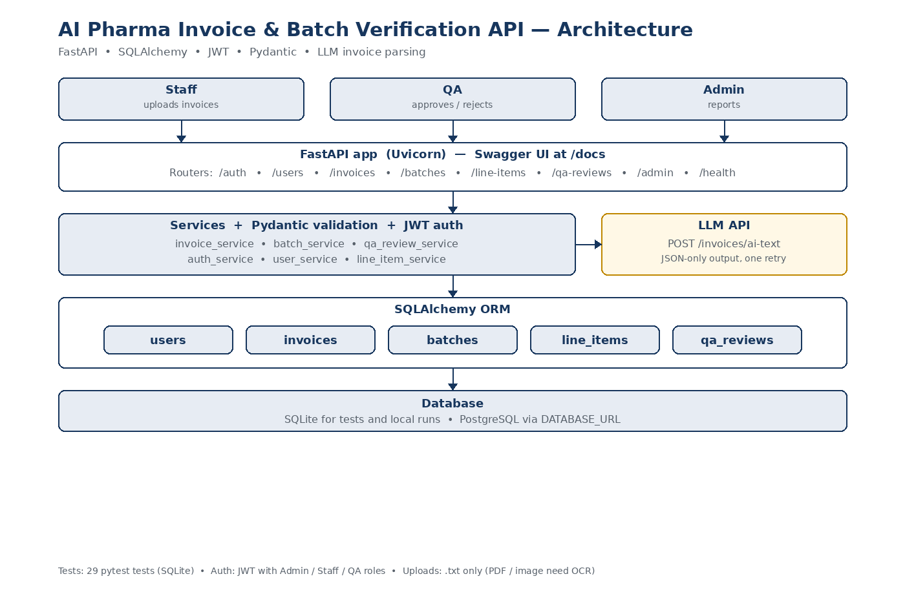
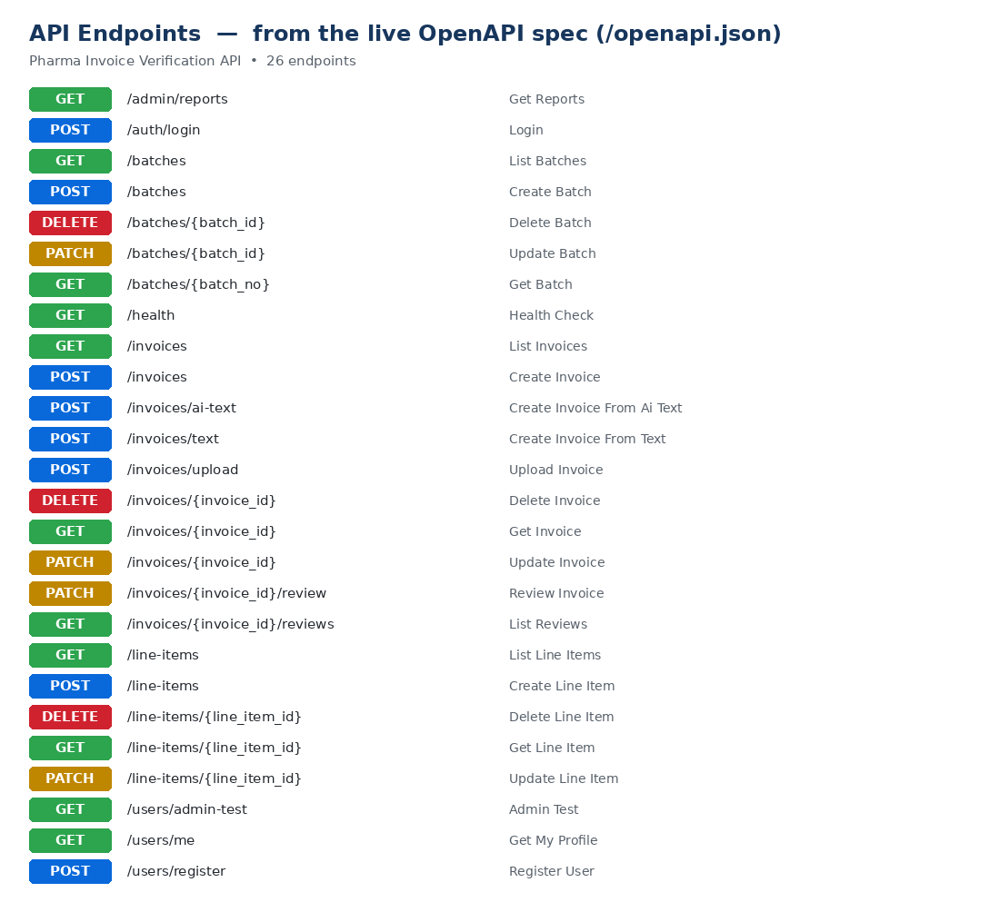
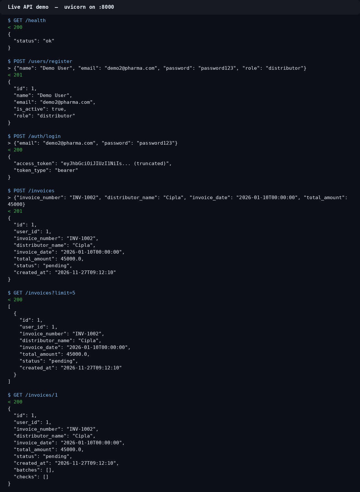
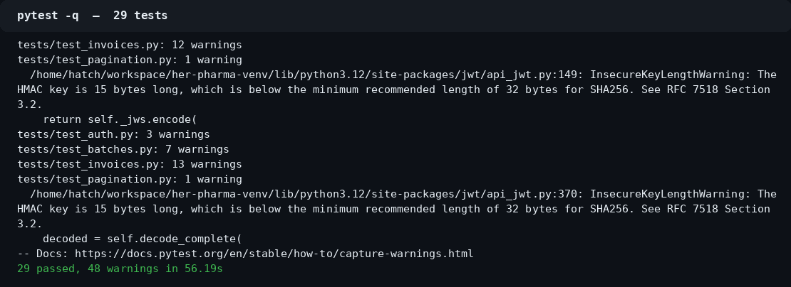

# pharma-distributor-fastapi

A backend API built with Python and FastAPI for a pharma distributor.
Staff upload supplier invoices and Certificates of Analysis, the system
checks batch numbers, expiry dates and duplicates, and QA approves or
rejects each invoice with a reason.

## What it does

- User registration and JWT login, with roles: admin, staff, qa, distributor
- Invoice CRUD, with status filter and pagination
- Batch CRUD, with expiry and near-expiry checks (near expiry is under 90 days)
- Line items for each invoice, with total price checked against quantity
- QA review: approve or reject an invoice, a reason is required on reject
- Admin report: invoice counts by status, batch counts by expiry
- AI invoice parsing: paste raw invoice text, the LLM returns JSON only,
  validated with Pydantic, one retry on validation failure
- File upload for .txt invoices (PDF and image upload needs OCR, not set up yet)

## API endpoints

| Method | Path | What it does | Auth needed |
| ------ | ---- | ------------ | ----------- |
| GET | `/health` | Health check, returns API status | No login |
| POST | `/users/register` | Register a new user (admin, staff, qa, distributor) | No login |
| POST | `/auth/login` | Log in and get a JWT access token | No login |
| GET | `/users/me` | Get the logged-in user's profile | Login |
| GET | `/users/admin-test` | Test endpoint that only an admin can reach | Admin role |
| POST | `/invoices` | Create an invoice | Login |
| POST | `/invoices/text` | Create an invoice from pasted invoice text | Login |
| POST | `/invoices/ai-text` | Create an invoice from LLM-parsed invoice text | Login |
| POST | `/invoices/upload` | Upload a .txt invoice file | Login |
| GET | `/invoices` | List invoices, with status filter and pagination (limit capped at 100) | Login |
| GET | `/invoices/{invoice_id}` | Get one invoice with its batches and line items | Login |
| PATCH | `/invoices/{invoice_id}` | Update an invoice | Login |
| DELETE | `/invoices/{invoice_id}` | Delete an invoice | Login |
| PATCH | `/invoices/{invoice_id}/review` | QA approve or reject an invoice (reason required on reject) | QA role |
| GET | `/invoices/{invoice_id}/reviews` | List the QA reviews on an invoice | Login |
| POST | `/batches` | Create a batch (expired and duplicate batches are rejected) | Login |
| GET | `/batches` | List batches, with pagination (limit capped at 100) | Login |
| GET | `/batches/{batch_no}` | Get one batch by batch number | Login |
| PATCH | `/batches/{batch_id}` | Update a batch | Login |
| DELETE | `/batches/{batch_id}` | Delete a batch | Login |
| POST | `/line-items` | Add a line item to an invoice | Login |
| GET | `/line-items` | List line items | Login |
| GET | `/line-items/{line_item_id}` | Get one line item | Login |
| PATCH | `/line-items/{line_item_id}` | Update a line item | Login |
| DELETE | `/line-items/{line_item_id}` | Delete a line item | Login |
| GET | `/admin/reports` | Invoice counts by status and batch counts by expiry | Admin role |

## Screenshots & Architecture









## Setup

```bash
python -m venv .venv
source .venv/bin/activate
pip install -r requirements.txt
cp .env.example .env
```

Fill in `.env` with your database URL, a secret key, and an LLM key
if you want to use the AI endpoint.

## Run

```bash
uvicorn app.main:app --reload
```

Swagger docs at http://127.0.0.1:8000/docs

## Tests

```bash
pytest
```

Tests use a local SQLite database, so no PostgreSQL is needed to run them.

## Project layout

- `app/main.py` - app setup and router registration
- `app/core/` - settings, password hashing, JWT, login dependencies
- `app/database/` - database connection and table setup
- `app/models/` - SQLAlchemy tables
- `app/schemas/` - Pydantic request and response shapes
- `app/services/` - database logic for each area
- `app/routers/` - API endpoints for each area
- `tests/` - pytest tests
